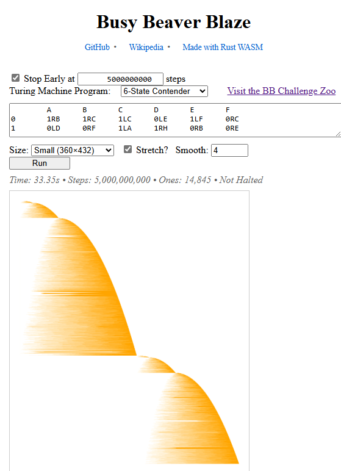

# Busy Beaver Blaze

**A Turing machine interpreter and visualizer** in Rust, Python, and WebAssembly.

- [Run the visualizer in your web browser](https://carlkcarlk.github.io/busy_beaver_blaze/).
- Watch [an animation](https://www.youtube.com/watch?v=qYi5_mNLppY) made with this program.

## Articles & Talks

- Python: [How to Optimize your Python Program for Slowness: Write a Short Program That Finishes After the Universe Dies](https://towardsdatascience.com/how-to-optimize-your-python-program-for-slowness/) in *Towards Data Science*.
- Rust: [How to Optimize your Rust Program for Slowness: Write a Short Program That Finishes After the Universe Dies](https://medium.com/@carlmkadie/how-to-optimize-your-rust-program-for-slowness-eb2c1a64d184) on *Medium*.
- [Video] Rust: [How to Optimize Rust for Slowness: Inspired by new Turing Machine Results](https://www.youtube.com/watch?v=ec-ucXJ4x-0) for the Seattle Rust Users Group on *RustVideos*.

## Features

- Python notebooks: [Turing machine basics](notebooks/turing_machines.ipynb), [interactive visualization](notebooks/interactive.ipynb), [fast-growing functions (tetration)](notebooks/tetration.ipynb), and [counting to infinity](notebooks/rule_set_1_and_2.ipynb). (See [Python Quickstart](#python-quickstart) below.)
- Run the champion [Busy Beaver](https://en.wikipedia.org/wiki/Busy_beaver) Turing machines for millions of steps in less than a second.
- Simulate your own Turing machines.
- Visualize space-time diagrams as the Turing machine runs.
- Control speed, step count, and sampling vs. binning:
  - Millions of steps in less than a second.
  - A billion steps in about 5 seconds.
  - 50 billion steps in about 10 minutes.
- Supports common Turing machine formats: "Symbol Major," "State Major," and ["Standard Format"](https://discuss.bbchallenge.org/t/standard-tm-text-format/60).
- Extended alphabets support up to 36 symbols (`0–9a–z`) and 26 states (`A–Z`). For example, `aRJ` writes symbol 10, moves right, and enters state J. Table symbol labels can use decimal numbers or lowercase base-36 letters.
- The WASM visualizer can color binary programs by the state that last wrote each nonzero cell, including the BB(10) preset.
- Optional **perfect binning** for tape visualization. By default, ever pixel in the image is the average of the (sometimes billions of) tape values that it represents.
- You can set settings via the URL hash fragment, for example, `#program=bb5&earlyStop=false`. Include `run=true` to run the program immediately.

## Techniques

- The Turing machine interpreter is a straightforward Rust implementation.
- The space-time visualizer uses adaptive sampling:
  - Initially records the full tape at each step.
  - If the tape or step count exceeds twice the image size, it halves the sampling rate.
  - Memory and time scale with image size, not step count or tape width.
- Even with pixel binning, memory use is a function
of the image size, not of the Turing run.
- Uses SIMD, even in WebAssembly, to speed up the pixel binning.
- For movie creation, multithreads rendering.

- Tips on Python integration with Rust: [*Nine Rules for Writing Python Extensions in Rust*](https://medium.com/data-science/nine-rules-for-writing-python-extensions-in-rust-d35ea3a4ec29) in *Towards Data Science*  

- Tips on porting Rust to WebAssembly: [*Nine Rules for Running Rust in the Browser*](https://medium.com/towards-data-science/nine-rules-for-running-rust-in-the-browser-8228353649d1) in *Towards Data Science*  
  
- Tips on SIMD in Rust:[*Nine Rules for SIMD Acceleration of Your Rust Code*](https://medium.com/data-science/nine-rules-for-simd-acceleration-of-your-rust-code-part-1-c16fe639ce21) in *Towards Data Science*  
  
## Web App Screenshot



- [Run the visualizer in your web browser](https://carlkcarlk.github.io/busy_beaver_blaze/).

## Related Work

- [The Busy Beaver Challenge](https://bbchallenge.org)
- [Quanta Magazine article](https://www.quantamagazine.org/amateur-mathematicians-find-fifth-busy-beaver-turing-machine-20240702/) and ["Up and Atom" video](https://www.youtube.com/watch?v=pQWFSj1CXeg&t=977s) on recent progress.
- [Fiery’s full-featured visualizer](https://fiery.pages.dev/turing/1RB1LC_0RD0RB_1RA0LC_1LD1RA) (TypeScript), used in the [Busy Beaver Challenge](https://bbchallenge.org/). It processes up to ~4 billion steps but does not animate the diagram’s development.
- For running Turing machines beyond trillions of steps, see this [math.stackexchange.com thread](https://math.stackexchange.com/questions/1202334/how-was-the-busy-beaver-candidate-fReador-6-states-calculated).

## Python Quickstart

Python 3.11 or newer is required. Clone the repository and use [uv](https://github.com/astral-sh/uv) to set up a Python environment and build the Rust extension before running notebooks or tests.

1. Clone the repository:

   ```bash
   git clone https://github.com/CarlKCarlK/busy_beaver_blaze.git
   cd busy_beaver_blaze
   ```

2. Create a virtual environment with [uv](https://github.com/astral-sh/uv):

   ```bash
   uv venv
   ```

3. Activate it: `source .venv/bin/activate` (macOS/Linux) or `.venv\Scripts\Activate.ps1` (PowerShell).
4. Install the Python dependencies in editable mode:

   ```bash
   uv sync --locked --extra dev
   ```

5. Build and install the Rust/PyO3 extension into that environment (requires [Rust](https://www.rust-lang.org/tools/install)):

   ```bash
   uv tool run maturin develop --release --features python
   ```

6. (Optional) Run the Python test suite:

   ```bash
   uv run pytest
   ```

7. Launch notebooks:

   ```bash
   cd notebooks
   uv run jupyter lab
   ```

   **Note for WSL users:** The browser may not open automatically. Copy the URL from the terminal output (e.g., `http://localhost:8888/lab?token=...`) and paste it into your Windows browser.

## Square Root movie frames

Generate Square Root movie frames sequentially with the same renderer used by
the web visualizer. Python builds include the required `image_pyramid` feature:

```python
from busy_beaver_blaze import (
    BB5_CHAMP, SqrtPngDataIterator, log_step_iterator,
)
from pathlib import Path

frames = SqrtPngDataIterator(
    log_step_iterator(10_000, 20),
    program=BB5_CHAMP,
    resolution=(1920, 1080),
)
for frame_index, (step_index, png_bytes) in enumerate(frames):
    Path(f"frame_{frame_index:07d}.png").write_bytes(png_bytes)
```

`frame_steps` must be nonempty and nondecreasing; duplicates are allowed. Index
zero is the initial blank tape. The iterator runs lazily on one thread, stopping
at the final requested index or before an unreachable index if the machine halts.
It supports `pixel_policy="binning"` (default) and `"sampling"`, plus hex `colors`.
Frame timing remains independent of the Square Root vertical axis.
See `example_python/movie_sqrt.py` for a command-line script that saves exact
native PNG bytes in a fresh output directory, before any resizing, text or
filters. Both movie generators also save `manifest.json` with the program,
rendering settings and exact step index of every frame. Keep these raw caches
so layout, text and filtering experiments never need to rerun a TM.
Post-processing adds a right-side Machine steps axis.
Muted gray labels sit to the left of the scale, overlapping the diagram;
the plot uses the space previously reserved for labels on the right.
`add_sqrt_step_axis(frame, step_index)` also works on saved frames without
rerunning the machine. It preserves the final resolution and fits the diagram
into a fixed inset. Tick positions follow the renderer's Square Root mapping,
including its initial blank sample, rather than assuming a linear vertical axis.
Ticks use equal machine-step intervals (1–10, then 10–100, and so on), placed
at uneven Square Root screen positions. Labels use full numbers with commas;
the final frame shows 10,000,000, 20,000,000, ..., 100,000,000.
At each new decade, the previous intermediate ticks fade out over the first
tenth of that logarithmic decade (up to about 1.26 times its boundary).
To encode old frames with the new axis, `example_python/post_sqrt_movie.py`
accepts `--source`, `--source-count`, `--steps`, `--frames`, `--fps`, and `--out`.
It adds a three-second final-frame hold by default (`--hold-seconds 0` disables
it). This extends the movie duration: 1,800 frames at 30 fps plus the hold is
63 seconds.
It streams annotated frames directly into FFmpeg, leaving the saved PNGs intact
and creating no additional frame files.

For the original Linear renderer, `example_python/movie_linear.py` saves raw
native PNGs with `PngDataIterator` and configurable `--workers` (default 8).
Then run `post_sqrt_movie.py --time-scale linear` with the same step count and
source frame count. Linear uses the same fading overlaid labels and final hold,
but its ticks are evenly spaced. The axis accounts for partially filled native
rows using `linear_time_extent` before resizing; output defaults to 1920×1080.
Movie frames still use logarithmic spacing between frames; this is independent
of the Linear vertical axis inside each frame.

`example_python/compare_movie.py` produces a stretched 3840×2160 comparison
with Linear on the left and Square Root on the right. It reads `--linear-source`
and `--sqrt-source` PNG directories and validates their manifests, including
matching programs, policies, rendering goals and every step index. It contains
no simulation path. For example, after generating both caches:

```bash
uv run python example_python/compare_movie.py \
  --linear-source /mnt/c/deldir/linear-100m-steps-1800-raw-frames \
  --sqrt-source /mnt/c/deldir/sqrt-100m-steps-1800-raw-frames \
  --frames 1800 --fps 30 --hold-seconds 3 \
  --out /mnt/c/deldir/comparison.mp4
```

Diagrams stretch to tall panels; axes, headings and counters are drawn afterward
at the final resolution, preserving text proportions. It also adds the final
three-second hold and can save a final-frame `--preview`.
Enlargement uses nearest-neighbor to preserve sharp cells and their colors;
area averaging is applied only to shrinking axes. No Gaussian blur or Lanczos
smoothing is applied to enlarged diagrams. Binning shades already present in
the raw PNGs remain intact.

Both encoding scripts support `--encoder auto|cpu|nvenc`, `--workers` (Python
frame-preparation processes), and `--cpu-threads` (CPU encoder threads).
The default is up to eight preparation processes and half the available CPU
threads. `auto` probes NVIDIA NVENC and uses it when available, with CPU x264
as the fallback. Explicit `nvenc` fails if unavailable. Worker output uses a
bounded shared-memory ring, so raw 4K frames are neither pickled between
processes nor accumulated without a limit. Output frame order is preserved.
NVENC CQ 18 and CPU CRF 18 are separate quality controls, not identical quality
or file-size guarantees.
On the RTX 3060 / 32-logical-processor workstation, preparing and NVENC-encoding
the same 120 late 4K frames from the Windows PNG caches took 27.7 seconds with
one Python process, 13.6 seconds with eight, and 13.2 seconds with sixteen.
These include process/encoder startup and filesystem I/O. Eight remains the
default because sixteen provided little additional benefit on that test.

`compare_movie.py --start-frame N --limit-frames M --hold-seconds 0` renders a
short range for benchmarking or checking appearance. `--resampling adaptive`
tests anti-aliasing for modest enlargements of dense patterns, while preserving
nearest-neighbor for large early cells. The default `cells` mode remains sharp.

## License

This project is dual-licensed under either:

- MIT License ([LICENSE-MIT](LICENSE-MIT) or <https://opensource.org/licenses/MIT>)
- Apache License, Version 2.0 ([LICENSE-APACHE](LICENSE-APACHE) or <https://www.apache.org/licenses/LICENSE-2.0>)

## Contributing

Contributions are welcome! Feature suggestions and bug reports are appreciated.
