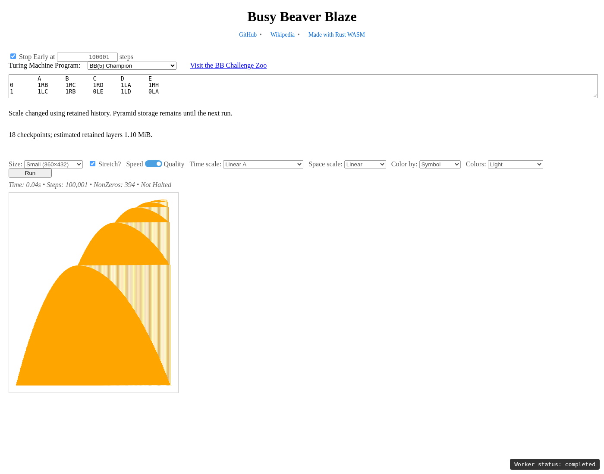
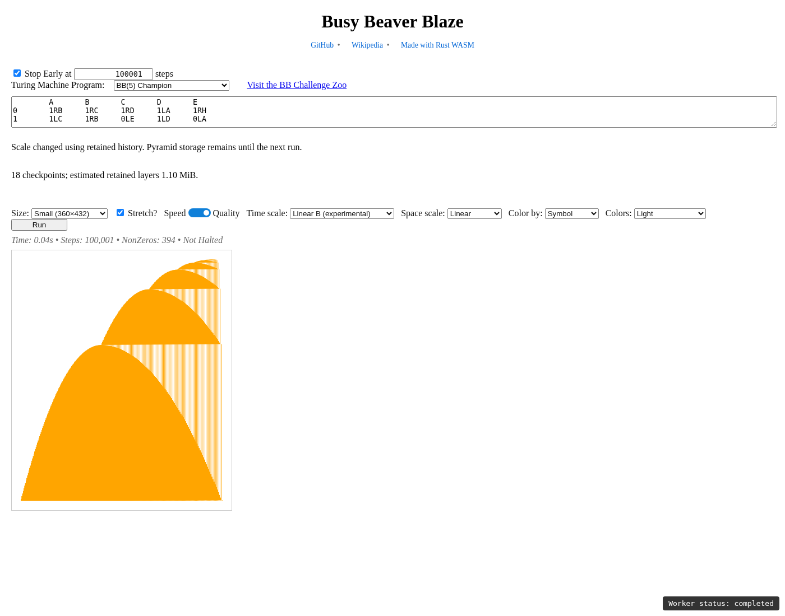
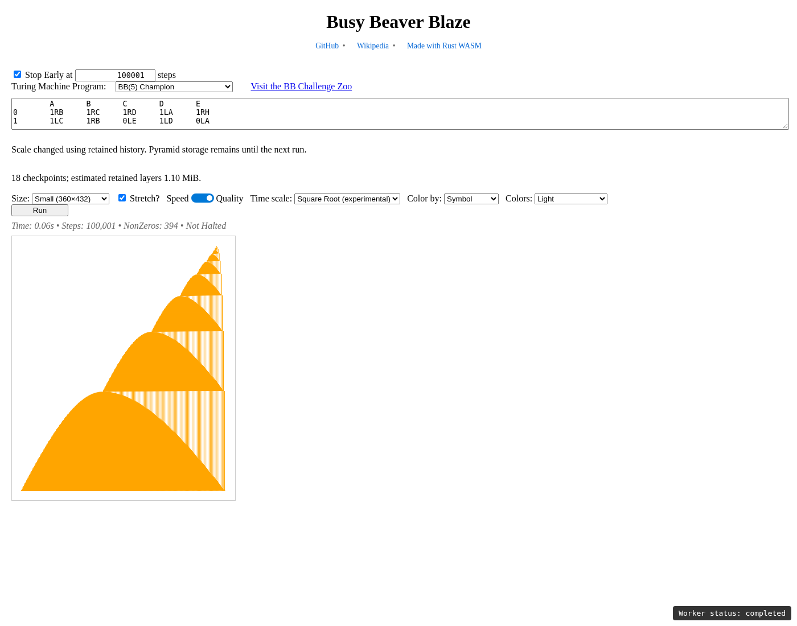
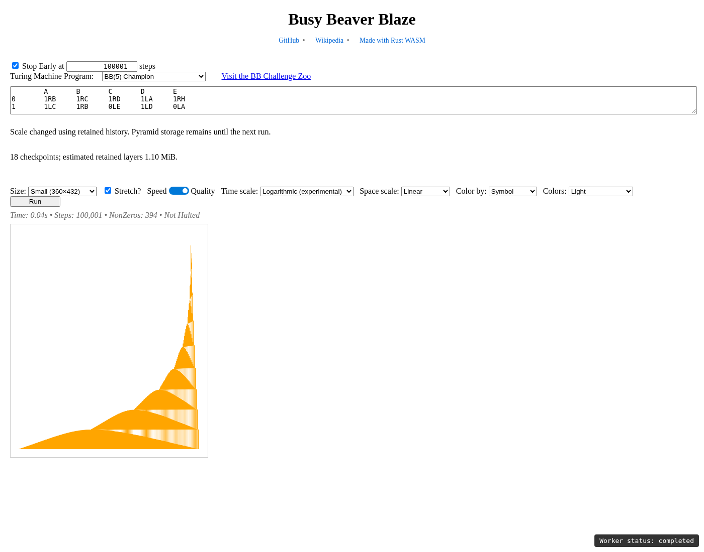

# Experimental multiresolution time scales

Open [the local preview](http://127.0.0.1:8000/time-scale-preview/).
The independent spatial extension is documented in [Space scaling](SPACE-SCALE.md),
including the nine X/Y comparison screenshots.

The published `v0.2.8` page, worker, and WASM assets remain unchanged. This work
is isolated on `log-images` and has not been merged or published.

## Architecture

The off-by-default Cargo feature `image_pyramid` exports `PyramidMachine`.
It owns one ordinary `SpaceByTimeMachine` and an `ImagePyramid` of cumulative,
complete native `SpaceTimeLayers` clones. Checkpoints occur after exactly
1, 2, 4, 8, … successful transitions, plus the initial blank image. There are
21 checkpoints after one million transitions. No tape or machine is cloned.

Linear A uses the existing machine, iterator, sampling/binning and PNG path.
It does not construct a pyramid or check history in its stepping loop. A native
inlining hint applies only when the experimental feature is compiled: extra
experimental callers otherwise change the compiler's decisions about the
reference layer iterator. Default builds retain the original hint.

One reconstruction routine supplies Linear B, Square Root and Logarithmic.
For each output row it chooses the earliest checkpoint covering that row's
entire actual time interval, or the active image if no checkpoint covers it.
It weights native symbol pixels by overlapping row durations, using `f64`
accumulators. Buffer entries use their actual power-of-two weights, rather
than prematurely padding a partial final row. Horizontal compression reuses
the existing SIMD/scalar helpers, aligns negative and nonnegative coordinates
at tape zero, and preserves blank padding. Output is another native
`SpaceTimeLayers`; only the existing PNG encoder applies the palette.
Stored levels remain immutable; rendering clones individual overlapping rows,
not the pyramid. Transient storage is an output image plus row buffers.

Time follows the reference renderer's sample convention: the initial tape is
sample zero and occupies `[0,1)`; the displayed Steps count includes this
sample. The nonlinear domain is `[0, displayed Steps)`. Its adjacent boundaries
are `T*u²` and `expm1(u*ln1p(T/t0))*t0`, with `t0=1`.
The boundary helper accepts another positive `t0` for future experiments.
Linear B instead uses the reference's actual power-of-two time bins, blank
final padding, output dimensions, and final pairwise compression. Endpoint
arithmetic uses `u128` before conversion, avoiding padded `u64` overflow.

The preview copies the established UI and imports its shared styles and
state-color transform. Its own worker and WASM package keep the experiment
separate. Pyramid modes support Quality and Speed. Speed picks the stored sample
containing the inverse-mapped output-row center, without averaging samples. Scale and
palette messages rerender retained data, including after stopping or halting.
A pyramid run can also show its active Linear A image. A Linear run can switch immediately using its current retained image;
previously discarded early detail cannot be recovered. Future checkpoints
are retained after switching. Old hashes default to
Linear A, and experimental selections are stored as `timeScale=linear-b`,
`timeScale=sqrt`, or `timeScale=log`.

## Raw-pixel comparison

All errors below are in 8-bit per-symbol values, before palette composition.
Tests compare binary machines, a three-nonzero-symbol machine, and BB5 rewritten
with five writing-state layers. Sizes include 2×1, 5×3, 16×8, 64×32 and 96×63;
checks cover stride transitions, both tape halves, checkpoint boundaries,
non-power-of-two counts, and incomplete final rows.

| Comparison | Maximum error | Mean absolute error | Differing pixels |
|---|---:|---:|---:|
| Small-size sweep, up to 4,096 transitions | 1 | 0.000337 | 283 / 839,569 (0.0337%) |
| BB5, through 1,000,001 transitions | 1 | 0.002448 | 888 / 362,728 (0.2448%) |
| BB6, through 1,000,001 transitions | 2 | 0.011141 | 3,745 / 342,794 (1.0925%) |
| BB5 writing-state layers | 2 | 0.005132 | 9,119 / 1,813,640 (0.5028%) |
| Three nonzero symbols | 1 | 0.000627 | 676 / 1,078,689 (0.0627%) |

Results match across all four SIMD/diff_row combinations. The small sweep
requires maximum ≤2 and mean <0.05. Larger cases require maximum ≤4 and mean
<0.03, allowing a little margin over measured results while detecting meaningful
regressions. Existing partition-comparison tests permit rounding differences
up to the sum of horizontal and vertical stride exponents. These tighter
experimental thresholds are measured regression limits, not universal error
bounds for arbitrary programs.

Independent small-image tests calculate Square Root and Logarithmic interval
averages directly. Additional tests cover immutable repeated rendering,
checkpoint counts, palette/scale changes without stepping, halt/restart, and
finite monotone boundaries through `u64::MAX`. A synthetic near-limit history
also reconstructs successfully without overflowing padded endpoints.

## Timings and memory

Measurements use the pinned nightly release build on an AMD Ryzen 9 7950X,
x86-64 Linux/WSL. Native timings exclude construction; WASM timings also exclude construction and module initialization. They are local measurements, not cross-browser guarantees.
See `results/` for measurements and test logs. Native Linear A comparisons use
an executable saved before the implementation and interleave four runs of each
build, with five trials per pixel policy per run. Each trial performs one
million BB5 transitions at 128×128 and encodes ten PNG frames.

| Linear A build | Quality median | Speed median | Peak process RSS range |
|---|---:|---:|---:|
| Before (main `f5bdb86`) | 152.284 ms | 8.620 ms | 3,420–3,548 KiB |
| After, default features | 156.271 ms | 8.780 ms | 3,160–3,424 KiB |
| After, experiment compiled | 154.413 ms | 8.153 ms | 3,248–3,424 KiB |

Default-build medians changed +2.62% for Quality and +1.86% for Speed;
experimental-build medians changed +1.40% and −5.42%. Individual trial ranges
overlap. No pyramid allocation, history branch or changed rendering arithmetic
is present in Linear A. There is no material measured memory increase. Before
adding the experimental-only inlining hint, native Speed had a reproducible
~20% regression from changed compiler decisions; that regression was resolved.

Pyramid measurements below use one million transitions; rendering is averaged
over five reconstructions plus PNG encodes. All cases retain 21 checkpoints.
The 26-layer stress program writes cyclic state identities while moving right,
so it also grows a one-million-cell tape.

| Program and goals | Linear A stepping | Pyramid stepping + capture | Retained layers | Linear B PNG | Square Root PNG | Logarithmic PNG |
|---|---:|---:|---:|---:|---:|---:|
| BB5, 128×128 | 152.169 ms | 162.632 ms (+6.88%) | 0.384 MiB | 0.858 ms | 0.860 ms | 0.919 ms |
| BB5, 360×432 | 155.512 ms | 167.071 ms (+7.43%) | 2.074 MiB | 4.300 ms | 3.447 ms | 2.812 ms |
| 26 layers, 128×128 | 2,860.237 ms | 3,159.703 ms (+10.47%) | 12.872 MiB | 14.290 ms | 16.296 ms | 15.605 ms |
| 26 layers, 360×432 | 2,952.581 ms | 3,271.374 ms (+10.80%) | 89.578 MiB | 70.205 ms | 75.697 ms | 67.678 ms |

Peak RSS over the stress measurements was 136,684 KiB (133.48 MiB).
The existing Criterion interpreter benchmark measured 3.83–4.59 ms per million
BB5 machine-only transitions (10 samples). It excludes visualization and is
recorded separately from the end-to-end visualization comparisons.

A separate Node/V8 WASM comparison interleaves the unchanged shipped package
and the rebuilt preview package, with the same BB5 work and dimensions. After
two warm-up trials, median Quality time was 137.494 → 140.348 ms
(+2.08%), and Speed was 12.871 → 13.382 ms
(+3.97%). This includes package/compiler/optimizer layout differences;
it does not add checkpoint work to Linear A. The native hint fixes the larger
native regression, but WASM still shows this small measured difference.
Both modes produce PNG bytes identical to the shipped package in regression
tests. Raw trial timings are in `results/wasm-timings.json`.

The layer byte estimate counts row/vector capacity and retained diff-row
caches. It excludes allocator metadata/alignment padding, BTreeMap nodes, the
machine/tape, PNG buffers, and transient reconstruction buffers. Process peak
RSS therefore provides a broader measurement. The preview shows checkpoint
counts and retained bytes, and warns above a 256 MiB retained-layer budget.
It retains all checkpoints rather than silently dropping history.

## Screenshots

All four screenshots use the same BB5 run, 100,000 simulated transitions
(displayed Steps: 100,001), 360×432 goals and the Light palette. The browser
script changes scales on retained data and asserts that the step count and
checkpoint/storage statistics remain fixed.

| Linear A | Linear B |
|---|---|
|  |  |
| Square Root | Logarithmic |
|  |  |

## Reproduce

From the repository root:

```bash
cargo test --release --features image_pyramid
cargo test --release --features image_pyramid image_pyramid -- --nocapture
cargo test --release --no-default-features --features image_pyramid image_pyramid
cargo test --release --no-default-features --features image_pyramid,simd image_pyramid
cargo test --release --no-default-features --features image_pyramid,diff_row image_pyramid
cargo run --release --example time_scale_baseline
cargo run --release --features image_pyramid --example time_scale_measure
wasm-pack build --release --out-dir docs/time-scale-preview/pkg --target web --features image_pyramid
node --test tests/wasm/time-scale.test.mjs tests/wasm/state-color.test.mjs
node tests/wasm/time-scale-benchmark.mjs
python3 -m http.server 8000 --bind 127.0.0.1 --directory docs
```

With Playwright installed, in another terminal:

```bash
node tests/wasm/time-scale-browser.mjs
```

`PLAYWRIGHT_MODULE` can point to an existing Playwright `index.mjs` instead of
installing a project dependency. `PREVIEW_URL` overrides the local server URL.
The browser test covers default URLs, instant switching, live controls,
cancellation, halting, state coloring, Quality enforcement, hash updates and
all four screenshots. For a restricted environment where wasm-pack cannot
create its tool cache, the equivalent build is:

```bash
cargo build --target wasm32-unknown-unknown --release --features image_pyramid
wasm-bindgen --target web --out-dir docs/time-scale-preview/pkg target-nightly/wasm32-unknown-unknown/release/busy_beaver_blaze.wasm
wasm-opt -Oz --strip-debug --strip-dwarf -o docs/time-scale-preview/pkg/busy_beaver_blaze_bg.wasm docs/time-scale-preview/pkg/busy_beaver_blaze_bg.wasm
```

All eight `cargo check` combinations (with/without `image_pyramid`, across the
four SIMD/diff_row combinations) passed. The full native suite with the
experiment enabled passed, as did the pyramid suite in each feature variant.
WASM tests also compare Linear A PNG bytes exactly against the unchanged
published package in both Quality and Speed.

Use a wasm-bindgen CLI matching Cargo.lock (0.2.100); an existing matching
cached CLI was used for this implementation. The preview package is checked in
so opening the preview does not require rebuilding it.

## Limitations and changed files

Source pixels are already quantized. Changing averaging order introduces small
rounding differences. A source row is treated as uniform within its interval;
nonlinear rows cutting through a compressed source row cannot recover its lost
sub-bin detail. This is intentionally a one-source-level-per-output-row
prototype. Floating-point time endpoints lose unit precision above 2^53, while
remaining finite and monotone; huge-time checks exercise arithmetic, not a
literal near-`u64::MAX` simulation. Memory grows with layers and log time;
large images with many writing-state layers can exceed browser budgets.
Sampling reconstruction selects representative stored rows and cannot recover
details discarded by sampling.

The new core is `src/image_pyramid.rs`. Existing Rust changes are restricted to
module exports, the off-by-default feature, retained-byte accounting in
`space_by_time.rs`, and the experimental native inlining attribute in
`space_by_time_machine.rs`. `examples/time_scale_baseline.rs` and
`examples/time_scale_measure.rs` reproduce performance measurements. Preview
assets, report, logs and screenshots live here; browser/WASM tests and timing
code live under `tests/wasm/time-scale*`. `AGENTS.md` records the workflow.

`cargo clippy --lib` is blocked by an existing `clap::ValueEnum` macro conflict
with the environment's forbidden lint settings in `src/compiled_runner.rs`.
No unrelated lint/configuration changes were made.

Proposed commit message: Add opt-in image pyramid and experimental time-scale preview
