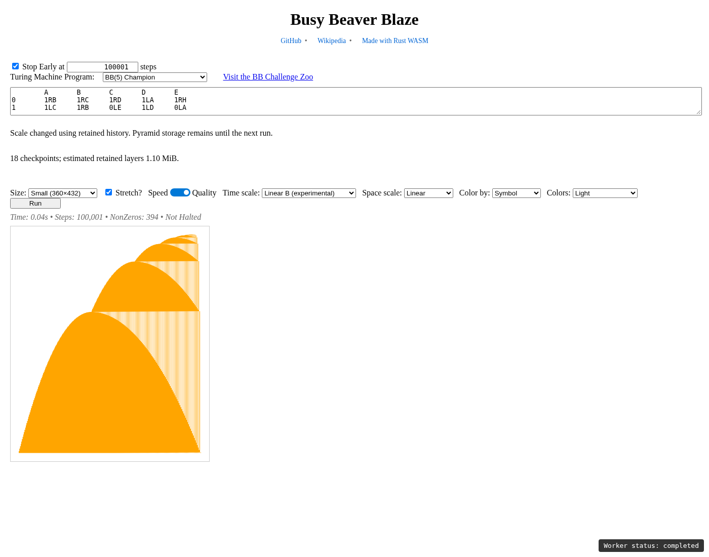
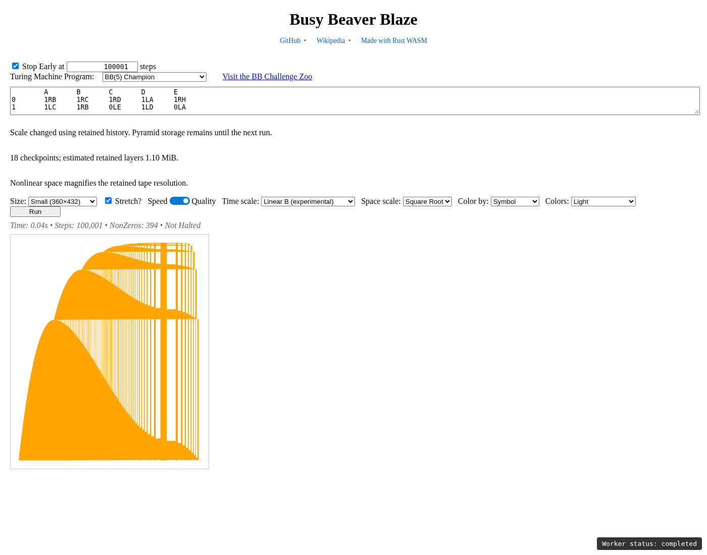
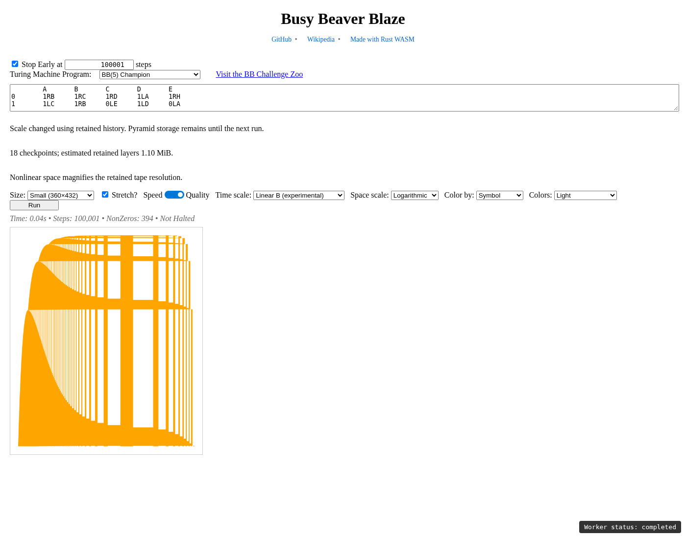
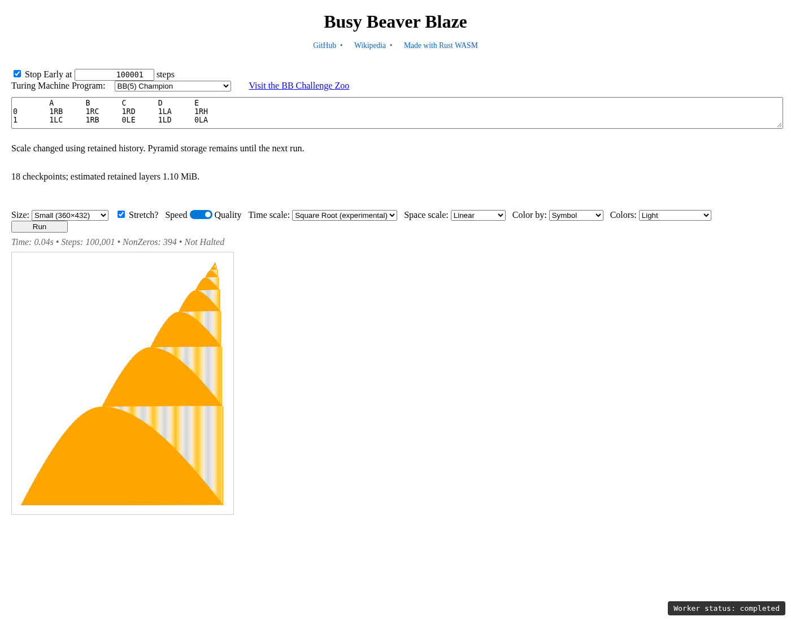
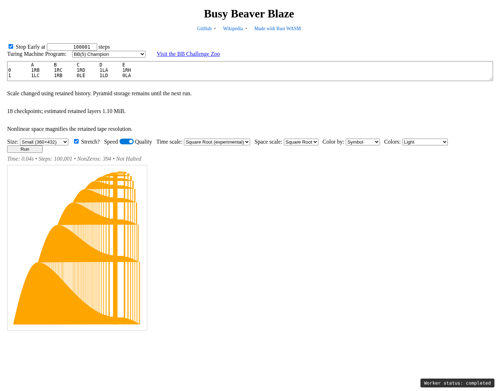
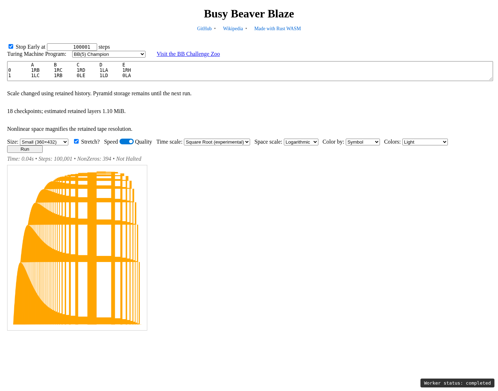
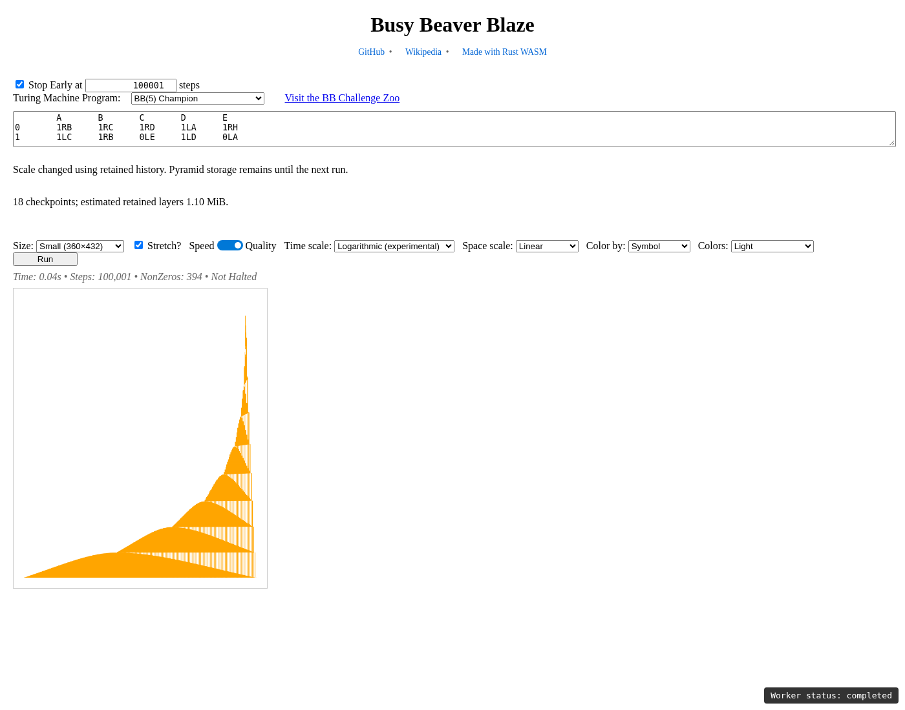
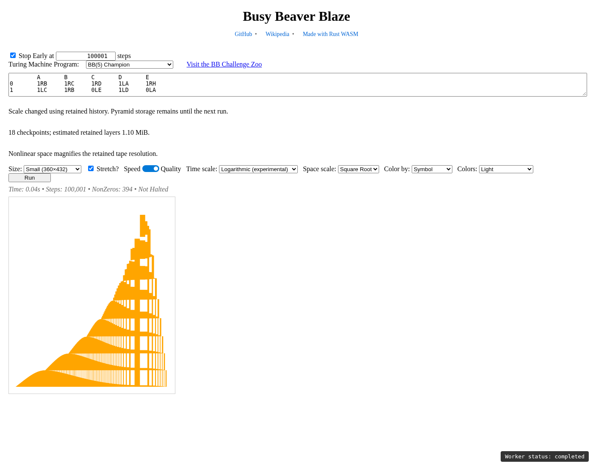
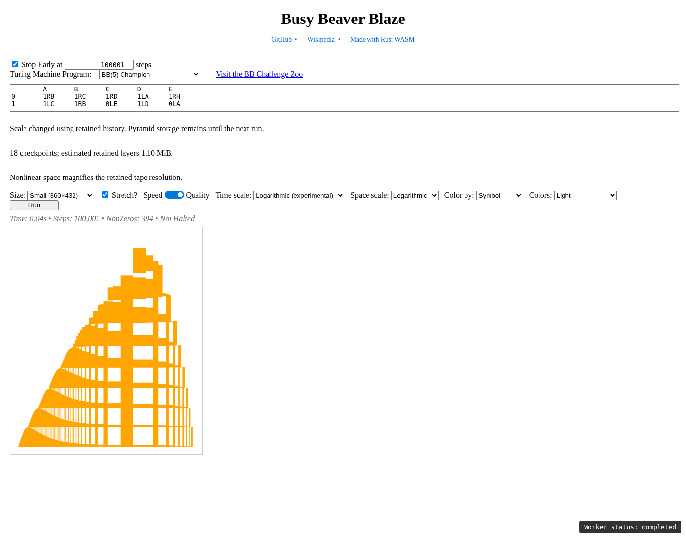

# Independent space and time scaling

Use [the experimental preview](http://127.0.0.1:8000/time-scale-preview/).
The **Time scale** selector offers only **Linear** and **Square Root**.
Pyramid size/checkpoint debug information is not displayed.
The **Space scale** selector offers only **Linear** and **1/Y**. Its Linear
default preserves old hashes; `spaceScale=row` selects 1/Y. Unsupported old X
settings fall back to Linear. The published `v0.2.8` app is unchanged.

### Current 1/Y fitting behavior

Each final output row stretches uniformly about tape zero by
`1/max(row/(height-1), 1/height)`. Before drawing, all nonzero symbol pixels in
all rows/layers are checked for overflow on both sides. If any would leave the
viewport, one shared horizontal shrink factor and translation bring the entire
stretched image back into bounds. The origin remains aligned across rows but
can move on screen, avoiding severe shrinking on asymmetric tapes. Relative
1/Y stretches remain intact; rows are never
fitted independently. The bottom row can therefore shrink too. Blank images
and already-fitting images keep factor 1; single-row images remain unchanged.
The fit uses whole occupied bins conservatively, because compressed pixels do
not retain sub-bin locations. No new history or stored resolution is needed.

[Example: fitted 1/Y X with Square Root Y](comparisons/x-row-y-sqrt.png).

The remaining measurements and coordinate-transform comparisons below record
the earlier experimental X modes, which are no longer selectable or accepted
by the public string API.

The time-only implementation was committed and pushed first as
[`bb97716`](https://github.com/CarlKCarlK/busy_beaver_blaze/commit/bb97716).
The spatial extension builds on that checkpoint on `log-images`.

Square and Exponential were evaluated as outward-stretching alternatives.
Square uses `sign(x) * x²`. Exponential uses the inverse of the normalized
logarithmic map: with global extent `M`, its exponent is
`abs(x) * ln(1 + M) / M`. This stays finite on wide tapes. Both reuse the same
pixel-overlap renderer and existing history. Hash values are `square` and `exp`;
Square Root and Logarithmic were retained for comparison at that stage.
Examples with Square Root Y: [Square X](comparisons/x-square-y-sqrt.png) and
[Exponential X](comparisons/x-exp-y-sqrt.png).

## Implementation

`SpaceScale` supplies signed forward/inverse functions with a one-cell scale
parameter: `x`, `sign(x)*sqrt(abs(x))`, and `sign(x)*ln1p(abs(x))`.
The helpers accept another positive unit for future experiments; there is no
extra UI parameter or perspective-specific mode.

Each render keeps the existing width and power-of-two stride. It derives a
single global interval from the reference's negative/nonnegative bin counts,
including blank padding in the outer bins. It transforms both endpoints,
divides the transformed interval uniformly, then inverts each column boundary.
Every row uses those same original tape-coordinate intervals. Zero stays at
its mathematically mapped position; it need not be the image's middle when
the tape extents are asymmetric.

`SpatialRow` integrates the native symbol densities in original tape-cell
coordinates. Separate prefix integrals grow away from zero on the negative
and nonnegative tape halves. This supports partial-bin overlaps and avoids
subtracting enormous tape offsets when magnifying a tiny region near zero.
The integral over an output column is divided by that column's original-space
width. Row workspaces are reused across rows and layers, and only one spatial
map is allocated per render.

For **Linear A**, a new `to_spatial_png()` API first uses the existing temporal
packing, including its final partial row and optional Sampling policy, then
resamples each packed native symbol layer in place. Linear space immediately
delegates to the old `to_png()` path; the worker also calls that original path
directly for default X/Y. No pyramid or new simulator bookkeeping is needed.
Speed selects the source sample containing the inverse-mapped transformed
column center; it never treats sampled values as averages.

For **pyramid Y modes**, the same reconstruction loop selects a cumulative
level by the output time interval. It aligns a cloned source row to the active
horizontal stride using the existing compression helpers, then integrates
that row over each spatial interval and weights by temporal overlap. The
accumulator stays floating point through both integrations; conversion to
`Pixel` occurs once per reconstructed row. Current-stride alignment is shared
by every Y mode, preserving Linear B's role as a validation of Linear A's
retained representation. The established final time-row packing is unchanged.

Color composition occurs only in the existing PNG encoder. Stored pyramid
levels and their resolutions are unchanged. Switching X uses a worker message,
rerenders running/stopped/halted data, and adds no checkpoints or persistent
transformed copies. The preview preserves size, Stretch, state coloring,
custom programs, palettes, Stop and Restart. Pyramid Y still requires Quality;
all three X settings also work with Linear A Speed.

## Numerical comparisons

The independent reference simulates original tape states and integrates
individual tape-cell/time-step rectangles directly. It does not use the
production spatial map or prefix helpers. Cases include BB5, three nonzero
symbols, negative and positive coordinates, 0/1/7/31/257 transitions, and all
nine mathematical combinations. Raw per-symbol pixels are compared before
palette composition.

With 512×512 goals, these simulations retain full cell/step resolution. Across
60,382 raw symbol pixels per combination, every maximum error is ≤1/255.
Mean absolute differences are:

| Time Y | Linear X | Square Root X | Logarithmic X |
|---|---:|---:|---:|
| Linear B | 0.000000 | 0.088669 | 0.124656 |
| Square Root | 0.017654 | 0.091716 | 0.112351 |
| Logarithmic | 0.026100 | 0.059769 | 0.080090 |

The single-level temporal/spatial values are already quantized. At only **8×5
goals**, magnifying compressed bins loses considerably more local detail.
These are direct-reference results over 763 symbol pixels per combination;
they measure information already lost in the retained image, as well as
rounding, rather than an error in the coordinate formulas:

| Time Y | Linear X max / mean | Square Root X max / mean | Logarithmic X max / mean |
|---|---:|---:|---:|
| Linear B | 0 / 0.000000 | 154 / 3.732634 | 147 / 5.453473 |
| Square Root | 46 / 0.875491 | 180 / 4.899083 | 168 / 6.891219 |
| Logarithmic | 20 / 0.428571 | 199 / 4.900393 | 191 / 6.867628 |

This demonstrates that very low retained resolution is insufficient for strong
nonlinear magnification. Storage resolution has not been automatically
increased. The UI explains that nonlinear space magnifies retained tape
resolution. A future precision increase should be evaluated against these
measurements, including its memory cost.

Separately, nonlinear-X **Linear A versus Linear B** comparisons around
power-of-two transitions and through 10,001 transitions cover **69,726 raw
symbol pixels**. Maximum difference is **2/255**, mean **0.029946/255**. This
isolates reconstruction differences from the much larger information loss
relative to original uncompressed tape data.

Every step through four actual horizontal-stride transitions and eight
vertical-stride transitions is checked, including the immediate before/at/after
states. Additional checks independently verify known square-root/logarithmic values,
signed symmetry, inverse mappings, continuity/origin alignment across stride
changes, blank partial coverage, representative Sampling, and positions up to
`u64::MAX`. A magnified `[-0.000001,0.000001]` interval retains the correct
constant value even when its source bin has stride 2^60. Linear X + Linear A
PNG bytes match the unchanged published WASM exactly for Quality and Speed,
including multisymbol and writing-state programs.

Uncompressed reference regression thresholds are max ≤1 and mean <0.13.
Compressed-case limits track the observed source-resolution loss separately;
they are not a general image-quality guarantee. Nonlinear A/B comparisons
require max ≤4 and mean <0.05. Full numerical logs are in `results/space/`.

## Performance and memory

Measurements use the pinned nightly release build on the same AMD Ryzen 9
7950X/Linux/WSL machine as the time-scale work. Native comparisons pin logical
CPU 6 and randomize build order over eight runs, each containing five trials
per pixel policy: 40 trials per build/policy. Each trial performs one million
BB5 transitions at 128×128 and encodes ten PNG frames. Construction is excluded.
The before binary was saved from the pushed time-only implementation.

| Default X/Y build | Quality median | Speed median |
|---|---:|---:|
| Before, default build | 155.3850 ms | 8.6985 ms |
| After, default build | 153.4315 ms | 8.7235 ms |
| Before, experiment compiled | 155.7490 ms | 8.2860 ms |
| After, experiment compiled | 155.9465 ms | 8.3570 ms |

The experiment-enabled changes are +0.13% Quality and
+0.86% Speed. Default-build changes are
-1.26% and +0.29% respectively. Trial ranges overlap.
Earlier unpinned/noisy runs were not used for this comparison. Native fast-path
instruction sequences for `nth_js`, `Machine::next` and `SpaceByTime::snapshot`
are identical after normalizing relocation addresses and panic-data names;
the comparison is recorded in `results/space/native-instructions.txt`.
Process RSS remained approximately 3.3 MiB in the default-view benchmark.

An interleaved Node/V8 comparison against the WASM package extracted from
`bb97716` (two warm-ups excluded) gives Quality **136.714 → 137.669 ms
(+0.70%)**, Speed **12.674 → 12.681 ms (+0.05%)**.
There is no new per-step or per-pixel spatial work in the default X/Y path.

The following rendering costs use one million transitions at 360×432,
five PNG renders per combination, pinned to CPU 2. This harness instruments
the Rust global allocator, so timings include that small measurement overhead;
comparisons within a row use the same instrumentation.

| BB5 time Y | Linear X | Square Root X | Logarithmic X |
|---|---:|---:|---:|
| linear-a | 1.613 ms | 4.154 ms | 5.315 ms |
| linear-b | 3.881 ms | 11.412 ms | 21.096 ms |
| sqrt | 5.952 ms | 21.943 ms | 15.384 ms |
| log | 3.233 ms | 12.249 ms | 13.815 ms |

| 26-layer stress time Y | Linear X | Square Root X | Logarithmic X |
|---|---:|---:|---:|
| linear-a | 15.738 ms | 67.124 ms | 72.581 ms |
| linear-b | 100.533 ms | 232.014 ms | 270.927 ms |
| sqrt | 88.546 ms | 292.182 ms | 342.301 ms |
| log | 76.541 ms | 263.265 ms | 308.531 ms |

The stress program cycles 26 nonzero writing-state identities while walking
right. It retains 21 checkpoints and **89.578 MiB** of layers; BB5 retains 21
checkpoints and **2.074 MiB**. Both values are unchanged across all twelve
selector combinations. No transformed pyramid levels are retained.

Temporary storage includes the PNG encoder, packed/output images, cloned source
rows and prefix/map workspaces. Peak requested bytes above the pre-render
allocator baseline, including the returned PNG, were:

| Case | Linear X | Square Root X | Logarithmic X |
|---|---:|---:|---:|
| BB5, linear-a | 1.407 MiB | 1.838 MiB | 1.849 MiB |
| BB5, linear-b | 1.674 MiB | 2.103 MiB | 2.111 MiB |
| BB5, sqrt | 1.505 MiB | 1.808 MiB | 2.065 MiB |
| BB5, log | 1.328 MiB | 1.478 MiB | 1.671 MiB |
| 26 layers, linear-a | 6.648 MiB | 7.542 MiB | 7.664 MiB |
| 26 layers, linear-b | 13.397 MiB | 14.291 MiB | 14.412 MiB |
| 26 layers, sqrt | 13.398 MiB | 13.920 MiB | 14.229 MiB |
| 26 layers, log | 13.395 MiB | 13.502 MiB | 13.599 MiB |

The spatial map and reusable prefix/scratch buffers require O(W) additional
working space. Source compression/output/PNG buffers account for the larger
shared peaks above. The measured allocation count for BB5 Linear A changes
from 32/frame with Linear X to 40/frame with either nonlinear X; BB5 Linear B
changes from 7,582 to 7,598/frame. Reusing workspaces avoids a prefix allocation
for every source row or symbol layer.

Peak process RSS over the rendering harness was **137,492 KiB (134.27 MiB)**.
Allocator measurements exclude allocator bookkeeping/fragmentation and internal
reallocation peaks; RSS includes more than live Rust-requested bytes. The
existing 256 MiB layer-budget notice remains in the preview. These are local
measurements, not cross-browser timing or memory guarantees. Raw measurements
and allocation counts for every combination are in `results/space/`.


## Nine screenshots

All screenshots use one retained BB5 history: **100,000 simulated transitions**
(displayed Steps: 100,001), 360×432 goals, Light palette. Every switch asserts
that steps, checkpoint count, and retained layer bytes stay unchanged. Linear B
represents the mathematical Linear Y row; Linear A is checked separately for
identity and all three spatial options.

| Time Y / Space X | Linear | Square Root | Logarithmic |
|---|---|---|---|
| Linear |  |  |  |
| Square Root |  |  |  |
| Logarithmic |  |  |  |

## Checks and reproduction

All eight `cargo check` variants passed: the four SIMD/diff_row combinations,
with and without the experimental feature. The full experimental native suite
passed **34 unit + 14 integration tests**. Each nondefault feature variant also
passed all **10 pyramid/integration-of-axes tests + 5 spatial helper tests**.
The existing interpreter Criterion benchmark completed. The three WASM test
files passed, and the Chromium regression script passed defaults, all twelve
selector combinations, live/after-stop changes, halting, sampling, state
colors, palettes, hash persistence, and the screenshot captures. Formatting
and whitespace checks passed. Existing no-diff_row unused-variable/import
warnings remain unchanged; no default-published assets were modified.

```bash
cargo test --release --features image_pyramid
cargo test --release --features image_pyramid spatial -- --nocapture
cargo test --release --features image_pyramid space_scale -- --nocapture
cargo run --release --features image_pyramid --example space_scale_measure
node --test tests/wasm/space-scale.test.mjs tests/wasm/time-scale.test.mjs tests/wasm/state-color.test.mjs
node tests/wasm/space-scale-benchmark.mjs
```

The WASM benchmark extracts its before-build package directly from the pushed
`bb97716` commit into a temporary directory. See the original [preview
instructions](README.md#reproduce) for the feature matrix, WASM tool versions,
local server, and Playwright invocation. `time-scale-browser.mjs` now also tests
live X changes, Linear A Speed without checkpoints, spatial hashes, and all
nine screenshot combinations.

Changed source files are `src/space_scale.rs` (maps/integrals),
`src/image_pyramid.rs` (shared X/Y accumulation),
`src/image_pyramid/spatial_tests.rs` (independent tape-data reference),
`src/space_by_time_machine.rs` (opt-in spatial API), and `src/lib.rs` (exports).
`examples/space_scale_measure.rs` instruments rendering allocations;
`Cargo.toml` registers the feature-dependent example. The preview's page,
worker, generated WASM package, browser/WASM tests, screenshots and reports
are updated, as is `AGENTS.md`.

Remaining limitations are quantized source detail, floating-point endpoints
above 2^53, and browser memory budgets for large multilayer histories. Spatial
scaling adds no retained pyramid storage. There is no increase to the internal
2× resolution and no new simulation/tape representation.

Proposed commit message: Add independent signed space scaling to the time-scale preview
